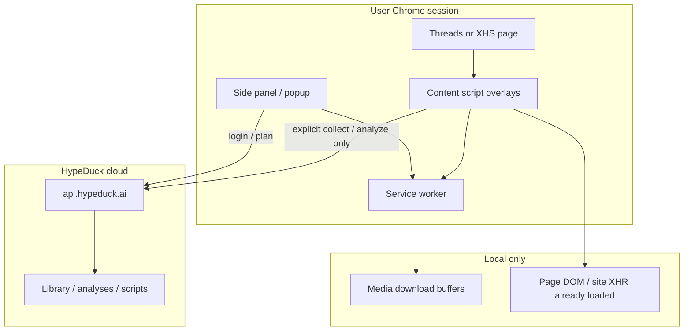

# HypeDuck 동작 관찰 스펙 (코드 없음)

역공학/디컴파일 없이, **공개 문서·Chrome 스토어 설명·가이드·실사용 스크린샷**만으로 정리한 행동 모델입니다.  
Sourcer MVP 구현·검증의 기준 문서입니다.

Sources:
- [hypeduck.ai/guide](https://www.hypeduck.ai/guide)
- [Chrome Web Store listing](https://chromewebstore.google.com/detail/hypeduck-reels-threads-in/kfnhdnbpeednbokckjghcbhhjbamfbgo) (v0.3.116 근처)
- [공개 REST API](https://www.hypeduck.ai/docs/api) / `https://api.hypeduck.ai`
- Nathan 제공 스크린샷: Threads 피드·다운로드 메뉴, 샤오홍슈 탐색 분석

---

## 1. 전체 아키텍처 (관찰 추론)

스토어 문구 요약:
- 스크롤하면서 **페이지(또는 사이트가 이미 불러온 엔드포인트)** 에 있는 제목·캡션·조회·좋아요·댓글·팔로워 등을 읽어 **오버레이**로 표시
- **수집·저장·분석을 사용자가 명시적으로 시작할 때만** 서버로 전송
- 미디어/썸네일 다운로드, 댓글보내기, 텍스트·링크 복사는 **요청 시에만**
- 미수집 raw page response / 임시 다운로드 버퍼는 로컬·일시적

→ Sourcer도 동일 원칙: 세션 내 관찰 + 명시 클릭 수집.

---

## 2. Threads — 화면별 동작

### 2.1 피드 카드 (관찰)

**위치**
- 포스트 왼쪽(또는 카드 좌측 바깥): 세로 메트릭 스택
- 포스트 오른쪽: 키워드/해시 칩 박스
- 브라우저 우측: 확장 사이드패널 (로그인 게이트)

**메트릭 스택 필드 (스크린샷 확정)**

| UI 라벨 | 예시 | 관찰된 의미 | Sourcer 추정 식 |
| --- | --- | --- | --- |
| 등급 + 배수 | `폭발 166.5배` | 조회÷팔로워 계열 | `views / followers` |
| 조회 | `9.4만` | 포스트 조회수 | DOM/페이지 데이터 |
| 팔로워 | `567` | 작성자 팔로워 | 카드/프로필 데이터 |
| 참여율 | `1.1%` | 참여÷조회 | `(likes+replies+reposts)/views*100` |
| 시간당 조회 | `1,978` | 속도 | `views / hours_since_post` |
| 확산 | `4.9` | 스프레드 점수 | 관찰상 로그스케일 유사 (`log10(views)` 근사) |

검증 메모: `9.4만 / 567 ≈ 165.8` → 배수 라벨과 일치.  
등급 색: 폭발=보라 계열, 그 외 회색 필 스택.

**데이터 출처 (추론, 코드 미확인)**
- Threads 웹은 조회수를 일반 유저에게 DOM에 항상 노출하지 않음
- 스토어: “page or the site's own endpoints through your existing signed-in browser session”
- 실무적으로는 **페이지 GraphQL/XHR 응답을 세션 안에서 읽는 방식**이 유력 (서버 무단 크롤 아님)
- Sourcer 다음 단계: 우리 content/background에서 Threads 네트워크 응답을 **사용자 브라우저 안에서만** 파싱

### 2.2 키워드 박스 (관찰)

- 캡션에서 추출한 토큰 (예: `감자`, `레시피`, `다이소`)
- 돋보기 아이콘 → 유사 검색으로 이어지는 UX
- 일부 카드에만 표시 / “분석중” 상태 가능 → **로컬 NLP 또는 서버 분석 비동기** 가능
- Sourcer MVP: 로컬 토큰 분리; 서버 NLP는 후순위

### 2.3 다운로드 메뉴 (관찰)

트리거: 포스트 근처 다운로드/액션 UI

| 액션 | 관찰 | 서버 전송? |
| --- | --- | --- |
| 영상 다운로드 | 있음 | 로컬(스토어: 요청 시에만) |
| 사진 N장 다운로드 | N 표시 | 로컬 |
| 링크 복사 | 있음 | 로컬 |
| 텍스트 복사 | 있음 | 로컬 |
| 스레드 텍스트 저장 | 있음 | 수집이면 서버 |
| 댓글 내보내기 CSV / Excel | 있음 | 로컬 export 가능성 큼 |
| 해시 표시 끄기 | 토글 | 로컬 UI |

로그인 안내가 메뉴에 뜨는 경우: **수집 통계/클라우드 기능은 로그인 게이트**, 다운로드 자체는 부분 개방으로 보임.

### 2.4 사이드패널 (관찰)

- 로고 + 버전 (`v0.3.1xx`)
- 언어 토글 (EN)
- 미로그인: 자물쇠 + “HypeDuck 로그인”
- 역할: 계정/플랜/수집 현황 허브로 추정

### 2.5 Threads 수집·자동 스캔 (가이드/요금제)

- 자동 스캔·일괄 수집: **Pro 이상**, PC Chrome 확장 필요
- 수집 자체는 크레딧 0 (요금제 FAQ)
- AI 분석만 크레딧 (글 2 / 영상 10 등)

Sourcer: 단건 수집 MVP → 자동 스캔은 백로그.

---

## 3. 샤오홍슈 — 화면별 동작

### 3.1 탐색/검색 상단 분석 패널 (스크린샷 확정)

제목 예: `샤오홍슈 탐색 분석 35개`

| 필드 | 예시 | 관찰 |
| --- | --- | --- |
| 노트 수 | 35 | 현재 로드된(또는 결과) 카드 수 |
| 팬 로열티 | — | 미계산/미노출 |
| 평소 좋아요 | 4,161 | 계정/결과 집합 baseline (중앙값·평균류) |
| 평균 좋아요 | 1.1만 | 결과 집합 평균 |
| 최고 성과배수 | 16.3배 | max(likes / 평소) |
| 필터 | 전체35 / 폭발4 / 강력1 / 우수3 / 보통… / 약함17 | 클라이언트 필터 |
| 정렬 | 성과배수 높은순 | 클라이언트 정렬 |
| Top 10 | 제목·좋아요·배수·등급 | 패널 내 리스트 |

### 3.2 카드 오버레이 (관찰)

| UI | 예시 |
| --- | --- |
| 등급+배수 배지 | `폭발 16.3배`, `약함 0.8배` |
| 좋아요 필 | `좋아요 6.8만` |
| 영상 | 일부 카드에 영상 표시 |
| 다운로드 | ⬇ 아이콘 |

가이드 매트릭스: 샤오홍슈 **분석 ✓ / 수집 — / 다운로드 ✓**  
→ 일괄 수집은 약하고, 벤치마킹·다운로드 중심.

### 3.3 XHS 배수·등급 (관찰 기반 임계)

스크린샷: `16.3배=폭발`, `5배=강력`, `0.8배=약함`  
→ 조회수 없는 플랫폼이라 **좋아요 / 평소 좋아요** 배수.

권장 임계 (Sourcer):
- 폭발 ≥10 · 강력 ≥5 · 우수 ≥2 · 보통 ≥1 · 약함 &lt;1

---

## 4. 네트워크·API (공개 표면만)

### 4.1 확장 ↔ 플랫폼 (추론)

| 방향 | 내용 | 근거 |
| --- | --- | --- |
| Threads/XHS → 확장 | 페이지가 이미 받은 HTML/JSON | 스토어 문구 |
| 확장 → 플랫폼 | 일반 브라우징과 동일 세션; 백그라운드 대량 크롤 아님 | 스토어 “does not track unrelated browsing” |
| 확장 → 로컬 디스크 | `chrome.downloads`류 | 다운로드 UX |

**관찰 체크리스트 (Nathan Chrome DevTools)**  
확장 켠 상태로 Threads 피드 스크롤 시:
1. `threads.net` GraphQL/API 요청에 `view_count` / `follower_count` 있는지
2. HypeDuck 도메인으로 **스크롤만으로** POST가 나가는지 (나가면 수집 정책과 불일치 → 버그/텔레메트리 구분)
3. 수집 버튼 클릭 시에만 `api.hypeduck.ai` 호출되는지

→ 결과를 이 문서 §4.3에 메모로 추가하면 Sourcer 네트워크 파서 설계에 바로 쓸 수 있음.

### 4.2 공개 REST API (`api.hypeduck.ai`) — 문서상

인증: `Authorization: Bearer hd_live_…`  
봉투: `{ data }` / `{ error: { code, message } }`  
쿼터 헤더: `X-Quota-Remaining` 등

공개 태그/영역 (문서):
- **내 계정**: `/api/v1/me`, accounts, stats overview
- **릴스**: 목록·단건·배치 upsert·URL/업로드 import
- **분석**: 분석 job 생성·조회
- **대본**: revision 목록·AI chat 수정
- **소싱**: discover, resolve-video(mp4), translate
- **문서**: `/api/v1/openapi.json`

참고: 공개 API 카피는 **인스타 릴스 수집·분석·대본** 중심.  
Threads/XHS 오버레이·배지는 **확장 로컬 + (로그인 시) 별도 수집 경로**로 보는 것이 맞음.

### 4.3 사용자 관찰 메모 (채우기)

| 시각 | URL/동작 | 요청 도메인 | 수집 클릭? | 메모 |
| --- | --- | --- | --- | --- |
|  |  |  |  |  |

---

## 5. 상태·게이트

| 기능 | 비로그인 | Free | Pro+ |
| --- | --- | --- | --- |
| 성과 배지 오버레이 | 가이드상 확장 설치 후 표시 | ✓ | ✓ |
| Threads 자동 스캔/일괄 수집 | — | 잠금 | ✓ |
| AI 분석 | — | 크레딧 | 크레딧 |
| 미디어 다운로드 | 부분 가능으로 보임 | ✓ | ✓ |
| 사이드패널 수집 현황 | 로그인 필요 UI | ✓ | ✓ |

---

## 6. Sourcer 매핑

| 관찰 기능 | Sourcer 상태 |
| --- | --- |
| Threads 메트릭 스택 | 구현 (DOM 기반; GraphQL 보강 필요) |
| Threads 키워드 칩 | 로컬 토큰 구현 |
| Threads 다운로드 메뉴 | 구현 |
| Threads 단건 수집 → 라이브러리 | `POST /api/items` |
| XHS 탐색 분석 패널 | 구현 (세션 median baseline) |
| XHS 카드 배지·다운로드 | 구현 |
| Side panel 로그인 UX | 팝업 API 키로 대체 (후순위 sidePanel) |
| GraphQL 세션 파서 | **미구현 — 다음 우선** |
| 자동 스캔 / AI 대본 | 백로그 |

---

## 7. 하지 않는 것

- HypeDuck CRX/확장 디렉터리 디컴파일·소스 덤프
- 서버 측 무단 대량 크롤
- 공개 API 키/타 사용자 데이터 무단 호출
